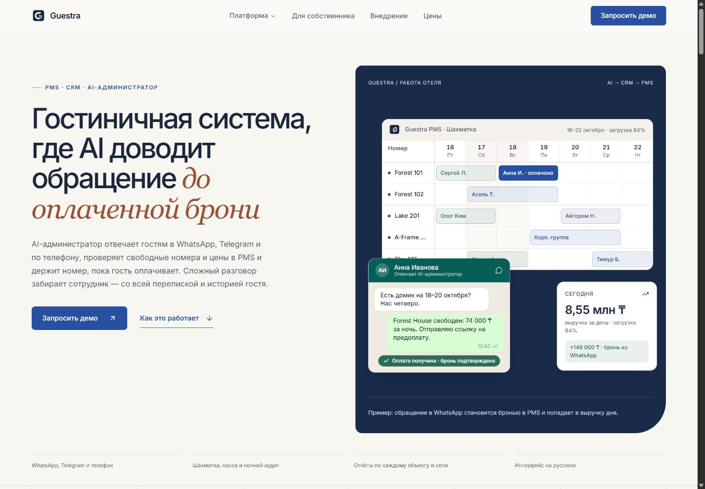
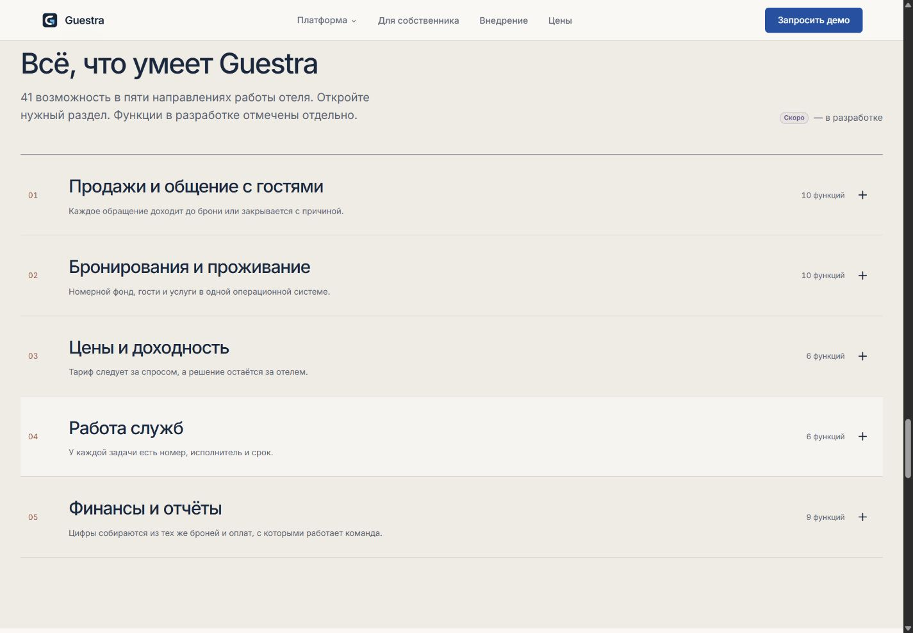
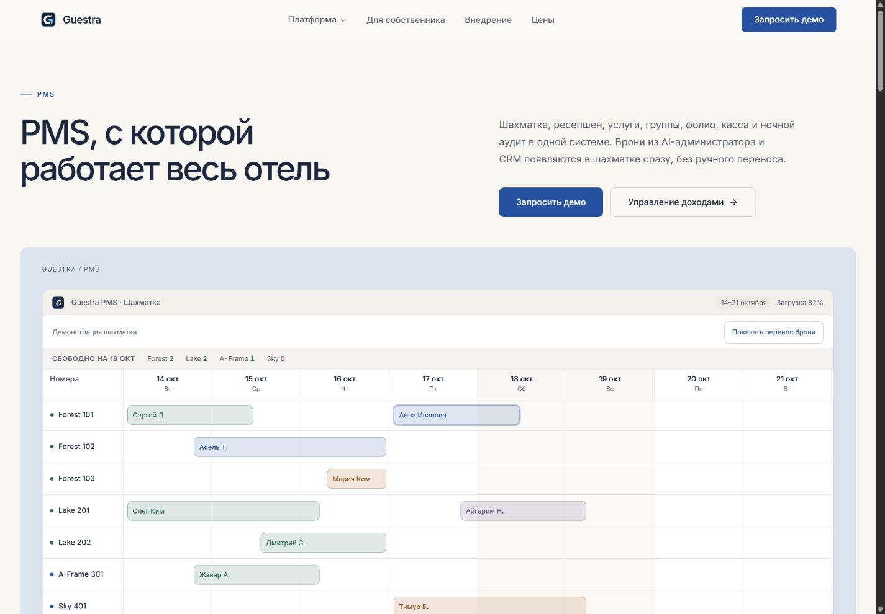
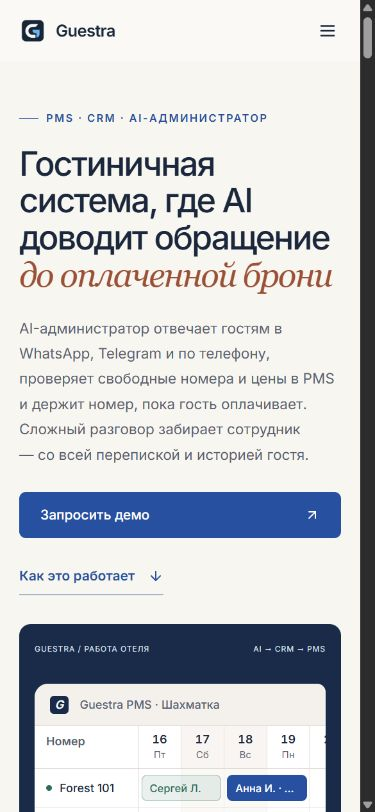

# Guestra: визуальное исследование и дизайн-доработка

29 октября 2026 года. Ветка `design/guestra-editorial-system`, база — `main` после PR #3.

## Повторное исследование

Просмотрены в браузере главная и все 13 внутренних страниц [Guestra](https://guestra.org), desktop и mobile. Дополнительно проверены каталог возможностей, формы, шахматка, сценарии AI, отчёты и связь модулей. Контекст продукта: публичный интерфейс [PMS](https://pms.guestra.org) и экран входа [CRM](https://crm.guestra.org). Закрытая часть CRM сверена по существующим исследованиям, а не представлена как осмотренная в этой сессии.

Исходные материалы: [исследование продукта и конкурентов](guestra-product-ux-competitive-research.md), [уточнённое направление](guestra-research-v2-final-direction.md). В этой итерации пересмотрено именно визуальное направление.

| Источник | Наблюдение в браузере | Решение для Guestra |
| --- | --- | --- |
| [Mews](https://www.mews.com/en), [страница PMS](https://www.mews.com/en/property-management-system) | Крупные контрастные плоскости; уверенная типографика; продукт показан крупным планом; на внутренних страницах меняются масштаб и композиция. Цвет отделяет главы, а не обводит каждую карточку. | Собственные цветовые поля, асимметричный первый экран, крупные витрины интерфейсов. Читаемая композиция раньше мелких деталей. |
| [Hostaway](https://www.hostaway.com/), [страница PMS](https://www.hostaway.com/features/property-management-system/) | Интерфейс рядом с объяснением задачи. Внутри продукта есть выбор конкретного сценария: календарь, входящие, цены, отчёты. В первом экране конкурируют несколько доказательств и CTA. | Один основной CTA; сценарии выбирает посетитель; сохранена предметная связь текста и интерфейса. |
| [Guesty](https://www.guesty.com/) | Широкая платформа разбита по задачам и размеру бизнеса. Крупный текст, курсивные акценты, тёплые поверхности, фотографии и продуктовые фрагменты создают разный ритм. | Разделение каталога по направлениям; сочетание спокойной фоновой поверхности, сильной типографики и продуктовых сцен. |
| [Breezeway](https://www.breezeway.io/) | Выбор Automated Workflows / Smart Checklists / AI Messaging меняет одну большую витрину. Проверено переключение Smart Checklists. Операционная задача подкреплена конкретной деталью интерфейса. | Шесть связок модулей показаны последовательно. В каждый момент есть один основной сюжет, все остальные остаются доступны. |

Выводы в таблице — дизайнерская оценка наблюдавшихся страниц, а не проверка коммерческих заявлений конкурентов. Материалы и интерфейсы конкурентов используются как исследовательский контекст.

## Диагноз исходной версии

- Белые карточки с одинаковым скруглением и весом повторяются в разделах с разными задачами.
- Центральный первый экран объясняет сложный продукт большим абзацем, но слабо задаёт индивидуальный характер.
- Шесть связок требуют параллельно прочитать шесть описаний и шесть мелких интерфейсов.
- На desktop каталог одновременно раскрывает 41 пункт в пяти узких колонках. Иерархия внутри списка слишком мелкая.
- Автоматический перенос брони, открытие карточки, смена обращения и анимация чисел отвлекают от чтения.
- На mobile часть полезных панелей просто скрыта. Длинный заголовок политики не помещается, отдельная таблица CRM расширяет страницу.

## Реализованное направление

Тёплая бумажная поверхность, глубокий синий, медный типографический акцент. Цвета витрин различают продуктовые направления: синий для PMS, песочный для доходности, серо-зелёный для операций, спокойный лиловый для AI. Белый используется для интерфейса внутри сцены.

Основной шрифт Inter остаётся локальным. В первом экране добавлен системный Georgia для смыслового акцента в существующем заголовке. Меняются насыщенность, масштаб, длина строки и интервалы. Глубину создают наложение интерфейсов, цветовые плоскости и локальные тени окон.

## Охват реализации

| Страницы | Что изменилось |
| --- | --- |
| `/` | Асимметричная композиция текста и продукта, навигационный индекс модулей, последовательные связки, отдельные сцены AI/PMS/отчётов, новый каталог, внедрение, FAQ и форма. |
| `/ai`, `/crm` | Общий новый вводный блок и цветная витрина входящих; оформление всех последующих секций и окон; управляемые демонстрации переписки и оплаты. |
| `/pms` | Заголовок и описание разведены по колонкам; широкая витрина шахматки; показ переноса по кнопке, карточка брони по выбору посетителя, прокрутка таблицы с клавиатуры. |
| `/revenue-management` | Песочная витрина прогноза; новое оформление симуляции, истории, тарифов и калькулятора; доступные названия ползунков и более удобная область взаимодействия. |
| `/operations`, `/owner` | Широкие продуктовые композиции; цвет разделяет направление; оформлены операционные списки, показатели, отчёты, журнал и последующие разделы. |
| `/platform` | Отдельный цветной вводный блок; сквозная история брони, связи систем и каталог приведены к общей системе оформления. |
| `/integrations` | Вводная схема каналов, AI/CRM и PMS; новый ритм каталога подключений; сохранены API и статусы будущих интеграций. |
| `/security` | Витрина ролей на отдельной поверхности; сохранены навигация по разделам, механизмы доступа и документы. |
| `/implementation` | Отдельная цветовая глава, последовательность этапов, подготовка, обучение и постепенный запуск AI. |
| `/pricing` | Песочный фон, пронумерованные факторы стоимости, самостоятельная форма расчёта. |
| `/updates` | Редакционная лента: дата и продукт слева, содержание справа; на mobile последовательное чтение. Все будущие функции сохранены. |
| `/privacy`, 404 | Читаемая документная композиция; заголовок политики помещается на узком экране; общий подвал и навигация. |

Общие элементы: компактные кнопки, новая палитра, более сдержанные радиусы, маркировка продуктовых окон, формы, меню и крупный типографический подвал. Декоративные Sparkles и градиентные аватары заменены предметной подачей.

## Содержание и поведение

- `src/data/capabilities.ts`, демонстрационные значения, FAQ, продуктовые тексты и статусы сохранены. Все 41 функция остаются в HTML каталога; нативные разделы можно раскрывать без JavaScript.
- WhatsApp и голосовой агент сохранены как продуктовые возможности. Публичный контакт — `sales@guestra.org`.
- Профиль гостя и фолио на главной доступны во вкладках на всех экранах. Журнал команды и раздел данных доступны и на mobile.
- Перенос в шахматке и получение оплаты в CRM запускаются посетителем. Чат показывается в завершённом состоянии и имеет запуск и паузу. Голосовой сценарий проходит один раз и имеет паузу и повтор.
- Числа сразу показывают итог; анимация применяется при изменении значения. Учитывается уменьшение движения.
- Форма удерживает фокус внутри диалога, закрывается по Escape и возвращает фокус кнопке. Мобильное меню также закрывается по Escape.

## Проверка

- `npm run typecheck` — успешно.
- `npm run test` — 34 теста: 19 приложения, 10 Worker, 5 новых сценариев раскрытия и демонстраций.
- `npm run build` — клиент, SSR, 14 пререндеренных страниц, `404.html`, sitemap.
- Браузерная проверка production-сборки: 15 страниц, включая `404.html`, на 320, 768, 1024 и 1440 px — 60 сочетаний. Один H1 на страницу; горизонтальное переполнение документа отсутствует. [Результаты](screenshots/browser-qa.json).
- Дополнительно проверены 390 px, мобильное меню, обязательные поля формы, Escape и возврат фокуса, все шесть связок, вкладки PMS, карточка и перенос брони, симуляция цены с клавиатуры, фильтры собственника и переключение службы.
- В финальной production-проверке ошибок браузерной консоли не обнаружено.
- Настройки Cloudflare, Worker и зависимости сохранены. Production-деплой не выполнялся. Отправка реального письма из production не запускалась; обработка успешной и неуспешной доставки проверена существующими тестами Worker и формы.

## Скриншоты

